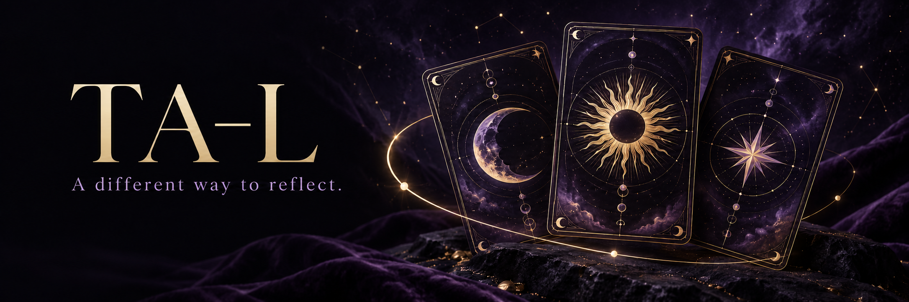

<p>
  
  
</p>

<br clear="all" />

**简体中文** · [繁體中文](docs/i18n/README.zh-TW.md) · [English](docs/i18n/README.en.md)

# TA-L

**让一次抽牌，成为整理问题、理解自己和继续对话的入口。**

TA-L 是结合手势抽牌、三牌阵与 AI 对话的塔罗体验。用户可以围绕一个具体问题，选择理性或共情的回应风格，通过牌面叙事观察过去、现在与未来的不同角度，再用追问把模糊感受整理成可以考虑的行动。夜色、星光与牌面动画服务于沉浸体验，产品定位是娱乐与自我反思。

## 适合谁使用

- 想借助牌面叙事整理问题、探索想法与感受的用户。
- 偏好理性分析或温和共情，希望选择回应方式的体验者。
- 研究手势交互、卡牌动画和流式 AI 对话的开发者。

## 7 个核心功能

### 1. 完整牌库与三牌阵

从 78 张塔罗牌中抽取三张不重复的牌，包含正位与逆位，并以过去、现在、未来三个位置呈现。 在同一问题下得到一组有位置关系的牌面，而不是三段互不关联的随机说明。

**当前：** 牌库、抽取和揭牌流程已实现。

### 2. 手势、键鼠多种抽牌方式

可开启摄像头，用指向、移动和握拳等手势参与选牌；也保留鼠标和键盘入口，配合洗牌与翻牌动画。 按设备条件选择交互方式，不开启摄像头也能完成抽牌。

**当前：** 手势在浏览器本地识别；需摄像头授权。

### 3. 理性与共情两种回应风格

在开始前选择偏重逻辑与行动建议的理性风格，或侧重感受梳理与温和表达的共情风格。 同一套牌面可以用更适合当前需求的表达方式展开，选择会传入解读与追问上下文。

**当前：** 已实现；风格选择不构成人格诊断。

### 4. 可跳过的偏好访谈

通过 10 道选择题描述思考和应对问题的偏好，形成用于本次体验的画像；也可以跳过，直接进入问题与抽牌。 让解读参考用户主动提供的偏好，画像按语言保存在当前浏览器，后续可查看或重新进行。

**当前：** 访谈已实现；模型画像需服务端配置，请求失败或输出格式不符时回退到本地规则画像。

### 5. AI 流式解读

把问题、牌位、正逆位、回应风格和可选画像交给服务端模型，逐段显示正文，并处理加载、失败与重试。 阅读围绕本次牌阵展开的解释与条件性建议，正文不展示模型的隐藏推理内容。

**当前：** 需要服务端模型密钥；新解读使用所选语言。

### 6. 结合上下文的继续追问

初次解读后可选建议问题或输入自己的问题，保留原始问题、牌阵与已有解读作为上下文，最多继续三轮。 把某个具体想法问清楚，无须重新抽牌；流式追问支持取消，失败后可重试。

**当前：** 已实现；依赖解读服务，追问保存另依赖历史存储。

### 7. 设备级历史回看

配置 Redis 后保存问题、牌面、回应风格、解读与追问，历史侧栏按当前设备标识读取最近记录并展开查看。 回顾自己此前提出的问题和获得的回应；当前接口展示最近 20 条，存储保留最近 50 条。

**当前：** 需配置历史存储；设备标识不等于账号认证或跨设备同步。

## 从开始到结果

1. 选择简体中文、繁體中文或 English，再选择理性或共情风格。
2. 完成或跳过偏好访谈，输入一个希望整理的具体问题。
3. 用手势或键鼠抽取并揭开三张牌，等待流式解读。
4. 针对关心的细节继续追问；存储已配置时，可在历史侧栏回看。

## 当前完成程度

- 可运行的产品原型，已有公开体验入口；代码覆盖抽牌、访谈、解读、追问与设备级历史。
- AI 解读与模型生成的画像需要服务端密钥；画像请求失败或输出格式不符时使用本地规则画像。历史需要 Redis，单独启动前端不等于这些外部服务已经可用。
- 界面、牌面文字与新解读请求支持三语；已有历史内容保持生成时的语言。

## 快速开始

Node.js 22。复制 .env.example 为 .env.local，在服务端填写 DEEPSEEK_API_KEY；历史功能另需 Redis 配置。普通 Vite 开发服务提供解读代理，历史 API 需相应服务端运行环境。

```bash
npm ci
# Copy .env.example to .env.local
# Set DEEPSEEK_API_KEY on the server
npm run dev
# http://localhost:5176
npm run lint
npm test
npm run build
```

## 使用边界

- 牌面用于娱乐与反思，不能确认未来事件或替代专业判断；表达应区分用户事实、牌面象征和条件性建议。
- 摄像头画面在浏览器本地用于手势识别；发起 AI 请求时，问题、牌阵及所选偏好会发送到服务端与模型服务。
- 设备标识不是身份认证；没有配置 Redis 时，历史接口不会提供持久化。

## 文档与项目管理

[在线体验](https://www.taro24.fun) · [产品与开发文档](docs/README.md) · [语言覆盖](docs/LOCALIZATION.md) · [项目任务](https://github.com/2432antony-13/TA-L/issues) · [检查记录](https://github.com/2432antony-13/TA-L/actions)
